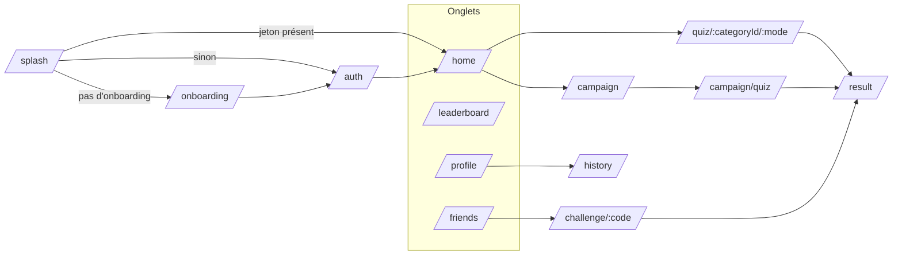

# Architecture

## En bref

La plupart des écrans fonctionnels font eux-mêmes leurs appels réseau avec Dio,
lisent les réponses sous forme de `Map<String, dynamic>` et gèrent leur état
local avec `setState`. Il n'y a pas de couche « repository » et presque aucun
modèle typé : `ResultScore` est l'exception. Les dossiers `core/models`,
`core/repositories` et `features/quiz/providers` sont vides. Riverpod ne sert
qu'à fournir le routeur (`routerProvider`).

La logique qui mérite d'être testée (lecture des questions, calcul du score,
paliers de victoire) est sortie des écrans dans de petits fichiers sans
dépendance à Flutter, couverts par les tests de `test/`.

## Arborescence

```
lib/
├── main.dart                       Démarrage, réglages d'accessibilité, MaterialApp
├── core/
│   ├── config/api_config.dart      URL de l'API, création des clients Dio, journaux réseau
│   ├── audio/                      Musique globale, effets et préférences sonores
│   ├── router/app_router.dart      Toutes les routes, écran de démarrage, barre d'onglets
│   ├── theme/app_theme.dart        Couleurs (AppColors) et thème Material (police Nunito)
│   └── network/dio_client.dart     Ancien client Dio — inutilisé
└── features/
    ├── onboarding/   Écran de démarrage animé + présentation en plusieurs pages
    ├── auth/         Connexion, inscription, Google Sign-In
    ├── home/         Accueil + liste complète des catégories
    ├── quiz/         Écran de jeu (tous les modes) + utilitaires de questions et de score
    ├── campaign/     Carte Campagne (régions → villes → niveaux)
    ├── result/       Écran de résultat, animations de victoire/défaite, lecture du score
    ├── friends/      Amis, demandes d'ami, défis
    ├── leaderboard/  Classements général, hebdomadaire et amis
    └── profile/      Profil, statistiques, badges, accessibilité, historique complet
test/                 Tests unitaires (lecture des questions, score, paliers de résultat)
assets/               Logo, mascotte (assets/mascot/ = versions détourées)
docs/                 Cette documentation
```

## Démarrage de l'application

[`main.dart`](../lib/main.dart) lit trois réglages dans `SharedPreferences`
avant d'afficher quoi que ce soit, puis les place dans des `ValueNotifier`
globaux :

| Réglage | Clé | Effet |
|---|---|---|
| Taille du texte | `accessibility_text_scale` (1.0 → 1.4) | `MediaQuery.textScaler` |
| Contraste renforcé | `accessibility_high_contrast` | couleurs primaire et texte assombries |
| Réduire les animations | `accessibility_reduce_motion` | `MediaQuery.disableAnimations` |

`IvoireQuizApp` écoute ces trois notifiers : un changement fait dans le profil
s'applique immédiatement à toute l'app, sans redémarrage. Les écrans qui animent
(résultat notamment) doivent lire `MediaQuery.of(context).disableAnimations`.

## Navigation

Le routeur ([`app_router.dart`](../lib/core/router/app_router.dart)) utilise
`go_router`. Les données passent d'un écran à l'autre par `extra` (des `Map`),
pas par des objets typés.



| Route | Écran | `extra` attendu |
|---|---|---|
| `/splash` | `SplashScreen` (dans le routeur) | — |
| `/onboarding` | `OnboardingScreen` | — |
| `/auth` | `AuthScreen` | — (le paramètre `?mode=login` est ignoré) |
| `/home` | `HomeScreen` (onglet 1) | — |
| `/home/categories` | `AllCategoriesScreen` | `{categories: List, selected_mode: String}` |
| `/leaderboard` | `LeaderboardScreen` (onglet 2) | — |
| `/friends` | `FriendsScreen` (onglet 3) | — |
| `/profile` | `ProfileScreen` (onglet 4) | — |
| `/history` | `HistoryScreen` | `List` des sessions |
| `/campaign` | `CampaignMapScreen` | — |
| `/campaign/quiz` | `QuizScreen(mode: 'campaign')` | `{session_id, level, questions}` |
| `/challenge/:code` | `QuizScreen(mode: 'challenge')` | — |
| `/quiz/:categoryId/:mode` | `QuizScreen` | brouillon de partie à reprendre (facultatif) |
| `/result` | `ResultScreen` | `Map` du résultat (voir [Fonctionnalités](fonctionnalites.md#résultat)) |

`categoryId` vaut le texte `null` pour les modes sans catégorie
(`/quiz/null/mixed`, `/quiz/null/daily`).

Les quatre onglets sont un `StatefulShellRoute.indexedStack` : chaque onglet
garde son état quand on change d'onglet. `MainScreen` affiche la barre du bas
(icône qui rebondit à la sélection).

L'écran de démarrage décide de la suite selon le stockage sécurisé : jeton
présent → `/home` ; onboarding jamais terminé → `/onboarding` ; sinon `/auth`.

## Réseau

[`ApiConfig`](../lib/core/config/api_config.dart) centralise la configuration :

- **URL** : `API_BASE_URL` (option `--dart-define`), par défaut
  `https://laravelquizz.studiobeyam.net`. Les appels partent vers
  `<API_BASE_URL>/api`.
- **Délais** : 10 s pour la connexion, l'envoi et la réception.
- **En-têtes** : `Accept` et `Content-Type: application/json`, plus
  `Authorization: Bearer <jeton>` quand on passe `authToken`.
- **Journaux** : un intercepteur écrit chaque requête et sa durée
  (`[API] → GET /api/...` puis `[API] ← ... 200 312ms`). Les identifiants
  numériques ou opaques des URL sont remplacés par `:id`.

Chaque écran qui appelle une route protégée lit le jeton (`auth_token`) dans le
stockage sécurisé puis appelle `ApiConfig.createDio(authToken: token)`. La
gestion d'une réponse **401** n'est pas centralisée : certains écrans suppriment
le jeton et renvoient vers `/auth`, tandis que d'autres affichent seulement une
erreur ou une vue vide.

Les réponses du backend suivent l'enveloppe Laravel
`{ "success": true, "data": ..., "message": "..." }`. Les erreurs de validation
(422) contiennent `message` et `errors`. Le détail de chaque appel est dans
[API](api.md).

## Stockage local

**Stockage sécurisé** (`flutter_secure_storage`, chiffré) :

| Clé | Contenu |
|---|---|
| `auth_token` | Jeton Bearer de l'utilisateur connecté |
| `onboarding_done` | `"true"` une fois la présentation terminée |

**Préférences** (`shared_preferences`, en clair) :

| Clé | Contenu | Écrit par |
|---|---|---|
| `accessibility_text_scale` / `_high_contrast` / `_reduce_motion` | Réglages d'accessibilité | Profil |
| `home_cache` | Dernier utilisateur, catégories et dernière partie affichés sur l'accueil | Accueil |
| `active_quiz_draft` | Partie en cours (questions, réponses, question courante) pour la reprendre | Quiz |
| `quiz_cache_<categorie>_<mode>` | Dernières questions reçues, pour jouer hors ligne | Quiz |
| `offline_results` | Résultats des parties jouées hors ligne | Quiz |
| `audio_music_enabled` | Active ou coupe la musique globale | Profil / contrôleur audio |
| `audio_effects_enabled` | Active ou coupe les effets courts | Profil / contrôleur audio |

`home_cache` est effacé après chaque partie enregistrée, pour que l'accueil
recharge la dernière partie.

## Audio

[`AppAudioController`](../lib/core/audio/app_audio_controller.dart) est une
instance unique initialisée avant `runApp`. Elle joue
`assets/audio/background.wav` en boucle dans toute l'application et conserve
un lecteur séparé pour chaque effet (bonne réponse, mauvaise réponse, victoire
et défaite). La musique se met en pause lorsque l'application quitte le premier
plan et reprend au retour si elle est activée.

Les erreurs du moteur audio sont journalisées mais ne remontent jamais jusqu'au
jeu. Les deux réglages sont indépendants et persistés dans
`SharedPreferences`.

## Thème

[`AppColors`](../lib/core/theme/app_theme.dart) :

| Nom | Couleur | Usage |
|---|---|---|
| `orange` | `#F77F00` | Couleur principale (boutons, accents) |
| `gold` | `#FFD700` | Points, étoiles |
| `textDark` | `#1A1A2E` | Texte principal, carte de score |
| `textGray` | `#6B7280` | Texte secondaire |
| `cardBg` | `#F8F9FA` | Fond des cartes |
| `neutral` | `#E5E7EB` | Bordures, puces |
| `correct` | `#22C55E` | Bonne réponse |
| `incorrect` | `#EF4444` | Mauvaise réponse, erreurs |

La police est **Nunito** (Google Fonts), chargée à l'exécution. Beaucoup
d'écrans redéclarent ces couleurs en constantes privées (`_orange`, etc.) plutôt
que d'utiliser `AppColors`.

## Logique isolée et testée

| Fichier | Rôle | Tests |
|---|---|---|
| [`quiz/utils/question_payload.dart`](../lib/features/quiz/utils/question_payload.dart) | Trouve la liste de questions dans les différentes formes de réponse de l'API | `question_payload_test.dart` |
| [`quiz/utils/score_calculator.dart`](../lib/features/quiz/utils/score_calculator.dart) | Bonne réponse ou non, nombre de bonnes réponses, points hors ligne | `score_calculator_test.dart` |
| [`result/models/result_score.dart`](../lib/features/result/models/result_score.dart) | Lit les chiffres d'un résultat (entiers, décimaux ou texte) | `result_score_test.dart` |
| [`result/widgets/result_celebration.dart`](../lib/features/result/widgets/result_celebration.dart) | Paliers parfait / victoire / moyen / défaite et étoiles (`ResultOutcome`, `resultStars`) | `result_outcome_test.dart` |
